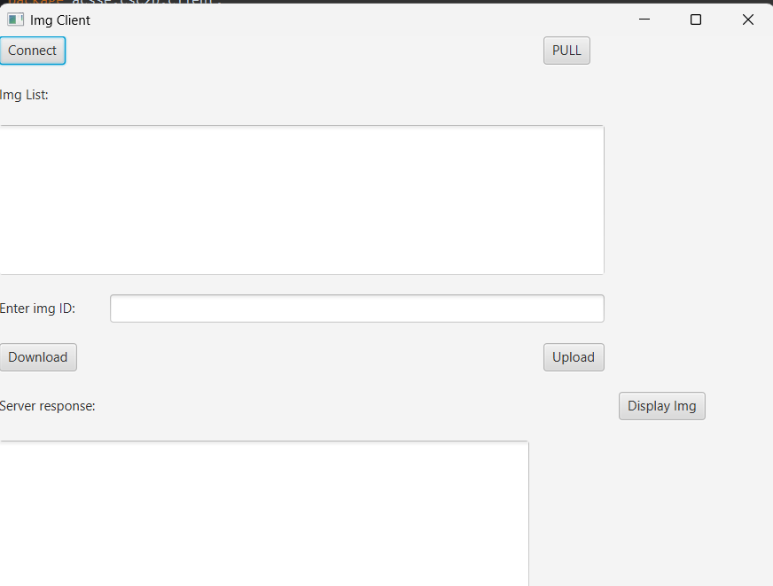
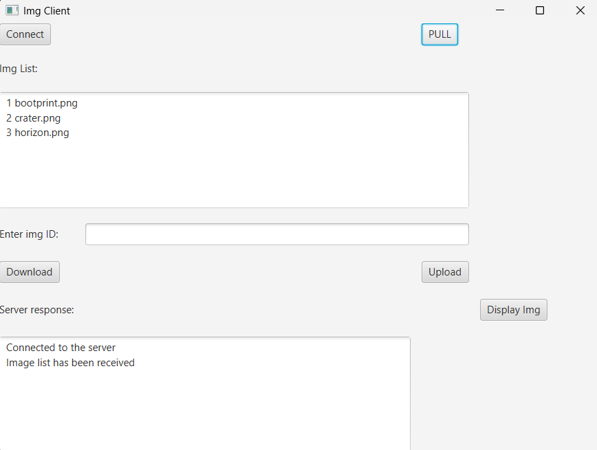
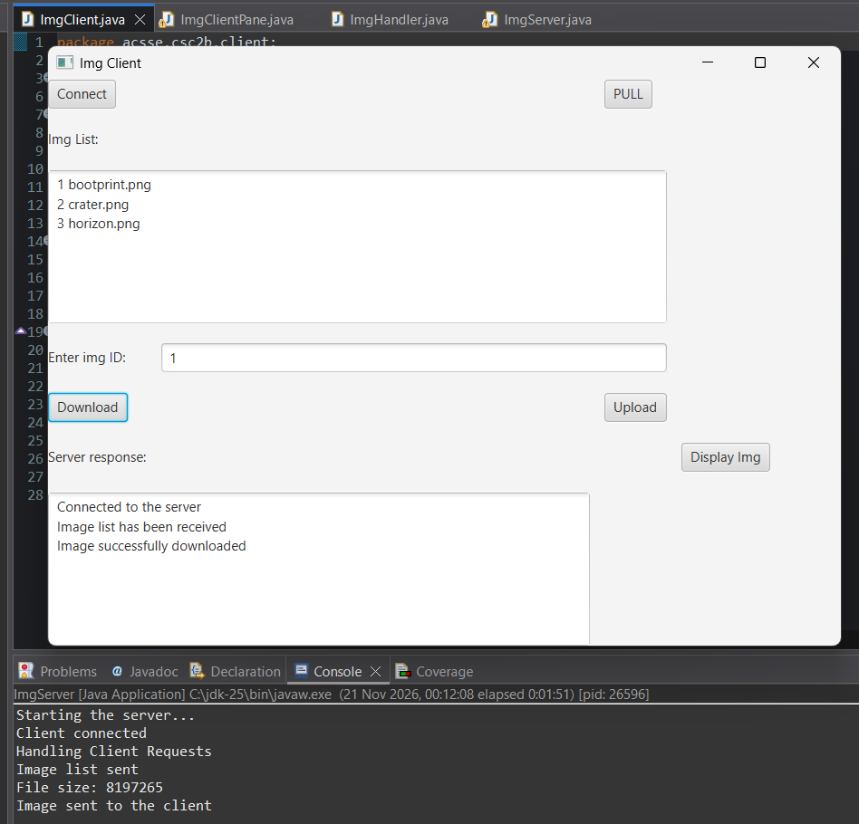

A Java client-server application developed for a second-year Computer Science practical at the University of Johannesburg.

The application allows users to upload, view and download images through a JavaFX interface. The client communicates with the server using Java sockets.

## Main Features

- Upload images to the server
- View a list of available images
- Download and display images
- Client-server communication using sockets
- JavaFX graphical interface

## Technologies

- Java
- JavaFX
- Java Sockets
- Eclipse IDE

## How to Run

1. Import the project into Eclipse.
2. Make sure Java and JavaFX are configured.
3. Run the server first.
4. Run the client.
5. Use the client interface to upload, list and download images.

The application uses port `5432`.

## Project Structure

- `src` - Java source code
- `data` - Images and application data
- `docs` - JavaDoc documentation

## Academic Note

This project was completed as an individual academic practical at the University of Johannesburg in August 2026.

## Screenshots

### Client Interface

### Available Images

### Downloaded Image

